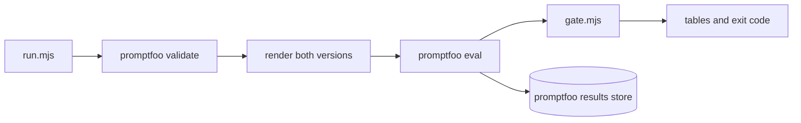

# How the guidance tests work

The guidance tests use [promptfoo](https://www.promptfoo.dev/). Each test sends a model a fixed scenario with guidance in its prompt, reads the choice it states, and compares two versions of that guidance: the version at a base ref and the version in the working tree.

This page explains how the parts fit together. To add a scenario or a test, or to run one, read [Guidance tests in CONTRIBUTING.md](../CONTRIBUTING.md#guidance-tests).

## The tests

| Command | Config | Module | Guidance in the prompt | Scenarios |
| --- | --- | --- | --- | --- |
| `pnpm eval:routing` | `routing.yaml` | `routing.mjs` | Workflow skill catalog, then one skill's body | `tests/workflow/contract-scenarios.json` |
| `pnpm eval:delegation` | `delegation.yaml` | `host-guidance.mjs` | Global guidance rendered by `scripts/host-config.mjs` | `tests/host-config/delegation-scenarios.json` |
| `pnpm eval:autonomy` | `autonomy.yaml` | `host-guidance.mjs` | Global guidance rendered by `scripts/host-config.mjs` | `tests/host-config/autonomy-scenarios.json` |
| `pnpm eval:workflow-rules` | `workflow-rules.yaml` | `workflow-rules.mjs` | The Workflow files that hold the rules under test | `tests/workflow/workflow-rules-scenarios.json` |

## Files

| File | Role |
| --- | --- |
| `<name>.yaml` | promptfoo config: two prompts labeled `base` and `working tree`, the providers, a test generator, and one `javascript` assertion |
| `providers.yaml` | The models, through the local CLIProxyAPI. The label (`claude` or `codex`) names the host whose guidance a prompt renders. |
| `host-guidance.mjs`, `routing.mjs`, `workflow-rules.mjs` | Prompt functions, test generators, and scoring for each test |
| `reply.mjs` | Parses the first JSON object in a reply. Invalid JSON is a failed answer, not an error. |
| `run.mjs` | The `pnpm eval:<name>` entry point: options, validation, the promptfoo run, and the gate |
| `gate.mjs` | Compares the two versions and prints the result tables |
| `../tests/evals/` | Gate tests, dry runs, and an end-to-end run against a local stub |

## One run



1. `run.mjs` reads the options and sets `EVAL_BASE_REF`, which the prompt functions read.
2. It runs `promptfoo validate` on the config.
3. It renders both versions once, so a bad base ref fails before any model call.
   - For `routing`, it also checks whether a Workflow `SKILL.md` changed. With no change, it exits 0.
4. It prints the call count. `--dry-run` stops here.
5. It runs `promptfoo eval` with `--repeat <attempts>`, `--no-cache`, and `--max-concurrency 4`. For each test, prompt, and provider:
   - The prompt function returns the system and user messages for its version.
   - The provider sends only `model` and `messages`.
   - The assertion classifies the reply into a choice and passes when the scenario accepts it. Its reason is the choice.
6. promptfoo saves the run to its local results store, which `pnpm eval:view` opens.
7. `gate.mjs` reads promptfoo's JSON export, prints one table per model, and sets the exit code.

## How a version is rendered

Prompt functions render each version lazily and only once. Loading a module runs no git command, so `promptfoo validate` works on a shallow CI checkout.

| Test | Base ref | Working tree |
| --- | --- | --- |
| delegation, autonomy | `git archive` of `host-config/`, `scripts/host-config.mjs`, and `plugins/field-guide` into a temporary directory, then `host-config.mjs apply` into a temporary home | `host-config.mjs apply` from the repository into a temporary home |
| routing | `git show` of each Workflow `SKILL.md` | The files on disk |
| workflow-rules | `git show` of each rule file | The files on disk |

## Scenarios and scoring

- A test generator turns each scenario into a promptfoo test. The description is the scenario `id`, and `metadata.scenario` groups its rows.
- Accepted answers sit in `metadata`, not `vars`, because promptfoo expands an array var into one test per element.
- `accept` is one list, or a list per host. The assertion picks the list for the provider label.
- A routing scenario becomes up to two tests: a skill step (pick a skill from the catalog) and a reference step (list the references the expected skill's body points to). The gate passes an attempt only when both pass.

## The gate

promptfoo scores each answer alone. Comparing two prompts takes a step after the run, so `run.mjs` sets `PROMPTFOO_FAILED_TEST_EXIT_CODE=0` and `gate.mjs` decides.

1. It groups result rows into attempts: one repeat of one scenario, for one version and one model.
2. It stops the run if any row is a provider error, or if a scenario has the wrong number of attempts.
3. It counts passing attempts per version. A row regresses when:
   - the working tree passes fewer attempts than the base, or
   - the scenario is marked `needsNewGuidance`, does not gain over the base, and the working tree misses an attempt.
4. Any regression makes the run exit 1.

## Environment

| Variable | Use |
| --- | --- |
| `CLIPROXY_API_KEY` | Key for the CLIProxyAPI. `--api-key-file` sets it from a file. |
| `CLIPROXY_BASE_URL` | Overrides the default `http://127.0.0.1:8317/v1`. The stub test uses it. |
| `EVAL_BASE_REF` | Set by `run.mjs` from `--base`. Needed only when you run `promptfoo eval` directly. |
| `PROMPTFOO_CONFIG_DIR` | promptfoo's home and results store. The tests point it at a temporary directory. |

`run.mjs` turns off promptfoo telemetry and update checks.

## Run promptfoo directly

`pnpm eval:<name>` is the supported entry point. To debug one scenario, you can call promptfoo yourself; the gate does not run then.

```sh
EVAL_BASE_REF=origin/main pnpm exec promptfoo eval -c evals/autonomy.yaml \
  --filter-pattern '^paid-eval-run$' --repeat 1 --no-cache
```

This makes paid calls. promptfoo exits 100 when any answer fails, including expected failures at the base.

## Limits

- A test checks the choice a model states in one call, not what an agent does across a task.
- Three attempts cannot separate a one-attempt difference from noise.
- The routing catalog holds only the Workflow skills, and only those the model can invoke.
- The scenarios, the accepted answers, and the guidance come from the same author.
