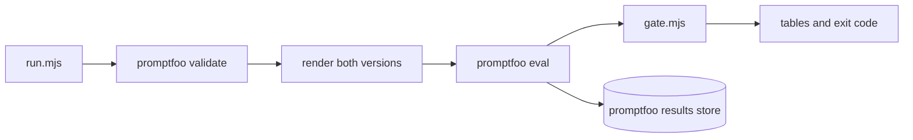

# How the guidance tests work

The guidance tests use [promptfoo](https://www.promptfoo.dev/). Each test sends a model a fixed scenario with guidance in its prompt and reads the choice it states. By default it compares two versions of that guidance, the version at a base ref and the version in the working tree, to catch regressions from a change. With `--no-base` it runs only the working tree and requires every attempt to pass, to check the current guidance on a model.

This page explains how the parts fit together. To add a scenario or a test, or to run one, read [Guidance tests in CONTRIBUTING.md](../CONTRIBUTING.md#guidance-tests).

## The tests

| Command | Config | Module | Guidance in the prompt | Scenarios |
| --- | --- | --- | --- | --- |
| `pnpm eval:routing` | `routing.yaml` | `routing.mjs` | Catalog of every skill a model can route to, then one skill's body | `tests/workflow/contract-scenarios.json` and the `routing` lists in `tests/skills/scenarios/<skill>.json` |
| `pnpm eval:delegation` | `delegation.yaml` | `host-guidance.mjs` | Global guidance rendered by `scripts/host-config.mjs` | `tests/host-config/delegation-scenarios.json` |
| `pnpm eval:autonomy` | `autonomy.yaml` | `host-guidance.mjs` | Global guidance rendered by `scripts/host-config.mjs` | `tests/host-config/autonomy-scenarios.json` |
| `pnpm eval:workflow-rules` | `workflow-rules.yaml` | `workflow-rules.mjs` | The Workflow files that hold the rules under test | `tests/workflow/workflow-rules-scenarios.json` |
| `pnpm eval:skill-rules` | `skill-rules.yaml` | `rules.mjs` | The `SKILL.md` of the standalone skill, or Field Guide, that owns the scenario | The `rules` lists in `tests/skills/scenarios/<skill>.json` |
| `pnpm eval:hill-climb` | `hill-climb.yaml` | `hill-climb.mjs` | The `hill-climb` skill and its references | `tests/skills/hill-climb-scenarios.json` |
| `pnpm eval:retrieval` | `retrieval.yaml` | `retrieval.mjs` | Global guidance rendered by `scripts/host-config.mjs`, then the Field Guide skill | `tests/host-config/retrieval-scenarios.json` |

## Files

| File | Role |
| --- | --- |
| `<name>.yaml` | promptfoo config: two prompts labeled `base` and `working tree`, the providers, a test generator, and one `javascript` assertion |
| `providers.yaml` | The models, through the local CLIProxyAPI. The label (`claude` or `codex`) names the host whose guidance a prompt renders. |
| `host-guidance.mjs`, `routing.mjs`, `rules.mjs` | Prompt functions, test generators, and scoring. `rules.mjs` builds every rules test: `rulesEval` for a fixed set of files, and the skill-rules tests |
| `workflow-rules.mjs`, `hill-climb.mjs`, `retrieval.mjs` | Rules tests that `rulesEval` builds |
| `skill-scenarios.mjs` | Reads `tests/skills/scenarios/<skill>.json` and the `--no-base` and `--skill` options |
| `reply.mjs` | Parses the span from the first `{` to the last `}` in a reply as JSON. Invalid JSON is a failed answer, not an error. |
| `run.mjs` | The `pnpm eval:<name>` entry point: options, validation, the promptfoo run, reading its JSON export, printing the tables, and the exit code |
| `gate.mjs` | Functions that compare the two versions and format the result tables |
| `../tests/evals/` | Gate tests, dry runs, and an end-to-end run against a local stub |

## One run



1. `run.mjs` reads the options and sets `EVAL_BASE_REF`, `EVAL_NO_BASE`, and `EVAL_SKILL`, which the prompt functions and test generators read.
2. It runs `promptfoo validate` on the config, and checks that the base ref exists unless the run has no base.
3. It generates the tests and renders the versions they use, so a read error fails before any model call.
   - In a comparison, routing selects only the tests a change can affect (see below). With none selected, the run exits 0.
4. It prints the call count. `--dry-run` stops here.
5. It runs `promptfoo eval` with `--repeat <attempts>`, `--no-cache`, and `--max-concurrency 4`. Without a base, it adds `--filter-prompts '^working tree$'`. For each test, prompt, and provider:
   - The prompt function returns the system and user messages for its version.
   - The provider sends only `model` and `messages`.
   - The assertion classifies the reply into a choice and passes when the scenario accepts it. Its reason is the choice.
6. promptfoo saves the run to its local results store, which `pnpm eval:view` opens.
7. `run.mjs` reads promptfoo's JSON export, passes the rows to `gate.mjs`, prints one table per model, and exits 1 on any failing row.

## How a version is rendered

Prompt functions render each version lazily and cache it once per process. The runner renders both versions to check the base ref, then promptfoo runs in its own process and renders them again. Loading a module runs no git command, so `promptfoo validate` works on a shallow CI checkout.

The base ref supplies only the guidance. Both versions use the working tree's scenarios, accepted answers, assertion code, and, for delegation, the model roster in `host-config/models.json` that classifies replies.

| Test | Base ref | Working tree |
| --- | --- | --- |
| delegation, autonomy | `git archive` of `host-config/`, `scripts/host-config.mjs`, and `plugins/field-guide` into a temporary directory, then `host-config.mjs apply` into a temporary home | `host-config.mjs apply` from the repository into a temporary home |
| routing | `git show` of each `SKILL.md` under `plugins/workflow/skills`, `skills`, and `plugins/field-guide/skills` | The files on disk |
| workflow-rules, skill-rules, hill-climb | `git show` of each rule file; a file the ref does not have is left out | The files on disk |
| retrieval | Host guidance as for delegation, then the Field Guide skill as for the rules tests | The same, from the working tree |

## Scenarios and scoring

- `metadata.scenario` holds the scenario `id` and groups a scenario's rows in the gate.
- Delegation, autonomy, and the rules tests turn each scenario into one test, described by its `id`.
  - Accepted answers sit in `metadata`, not `vars`, because promptfoo expands an array var into one test per element.
  - `accept` is one list, or a list per host. The assertion picks the list for the provider label.
- Routing turns each scenario into zero, one, or two tests:
  - `<id> skill`, unless the scenario is `explicit`: it passes when the chosen skill equals `expectedSkill`, where `null` means no skill, or is listed in `alsoAccept`.
  - `<id> reference`, when the scenario has an `expectedReference`: it passes when the listed file names include it.
  - An explicit scenario with no expected reference makes no test. The gate passes an attempt only when every test of the scenario passes.
- The routing catalog lists every skill without `disable-model-invocation: true`. A manual-only skill appears only in `explicit` scenarios, which test its reference pointers; its rules go in `skill-rules`.
- In a comparison, routing runs a skill step only when the catalog (a routable skill's name or description) changed, and a reference step only when its skill's body changed. A scenario whose expected skill the base cannot offer is treated as `needsNewGuidance`.
- `--skill <name>` selects the scenarios in that skill's file, plus any other scenario that expects or also accepts it. It implies `--no-base`.

## The gate

promptfoo scores each answer alone. Comparing two prompts takes a step after the run, so `run.mjs` sets `PROMPTFOO_FAILED_TEST_EXIT_CODE=0` and `gate.mjs` decides.

1. It groups result rows into attempts: one repeat of one scenario, for one version and one model.
2. It stops the run if any row is a provider error, or if a scenario has the wrong number of attempts.
3. It counts passing attempts per version. In a comparison, a row regresses when:
   - the working tree passes fewer attempts than the base, or
   - the scenario is marked `needsNewGuidance`, does not gain over the base, and the working tree misses an attempt.
4. Without a base, a row fails when the working tree misses any attempt. The base column shows a dash.
5. Any regressed or failing row makes the run exit 1.

## Environment

| Variable | Use |
| --- | --- |
| `CLIPROXY_API_KEY` | Key for the CLIProxyAPI. `--api-key-file` sets it from a file. |
| `CLIPROXY_BASE_URL` | Overrides the default `http://127.0.0.1:8317/v1`. The stub test uses it. |
| `EVAL_BASE_REF` | The base ref, `origin/main` when unset. `run.mjs` sets it from `--base`; set it yourself to compare another ref in a direct run. |
| `EVAL_NO_BASE`, `EVAL_SKILL` | Set by `run.mjs` from `--no-base` and `--skill`, so promptfoo's test generators select the same tests. |
| `PROMPTFOO_CONFIG_DIR` | promptfoo's home and results store. The tests point it at a temporary directory. |

`run.mjs` turns off promptfoo telemetry and update checks.

## Run promptfoo directly

`pnpm eval:<name>` is the supported entry point. To debug one scenario, you can call promptfoo yourself; the gate does not run then.

```sh
EVAL_BASE_REF=origin/main pnpm exec promptfoo eval -c evals/autonomy.yaml \
  --filter-pattern '^paid-eval-run$' --repeat 1 --no-cache
```

This makes paid calls. promptfoo exits 100 when any answer fails, including expected failures at the base.

## Limits

- A test checks the choice a model states in one call, not what an agent does across a task.
- Three attempts cannot separate a one-attempt difference from noise.
- The routing catalog holds only this repository's skills. Collisions with downloaded or employer skills stay unmeasured.
- The scenarios, the accepted answers, and the guidance come from the same author.
